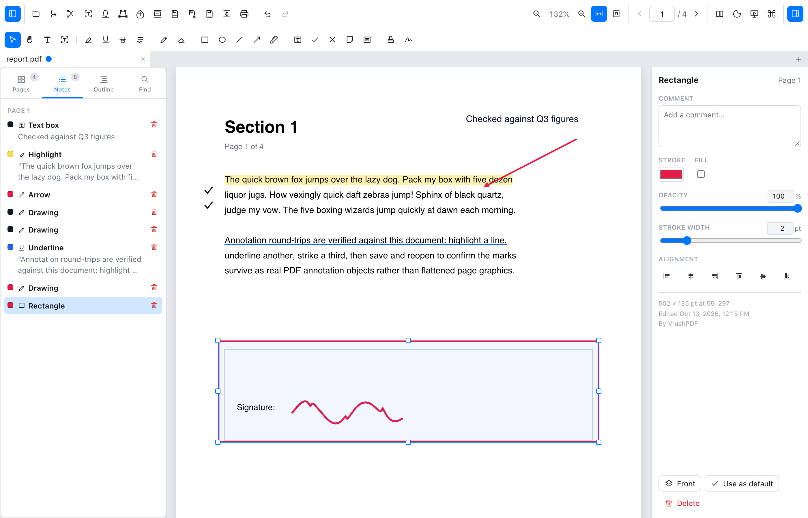
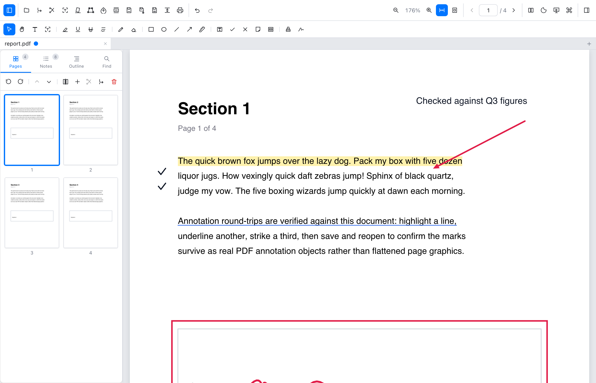
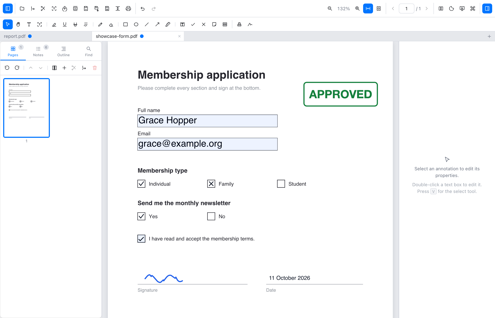
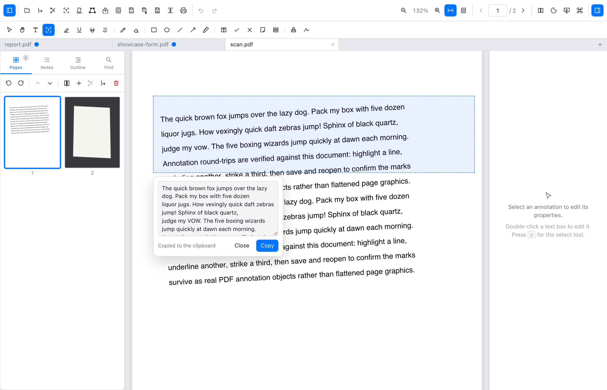
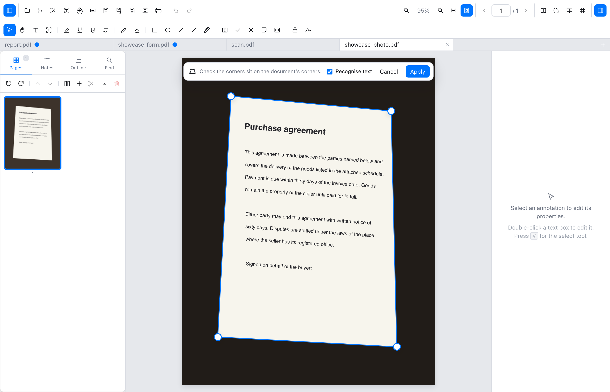
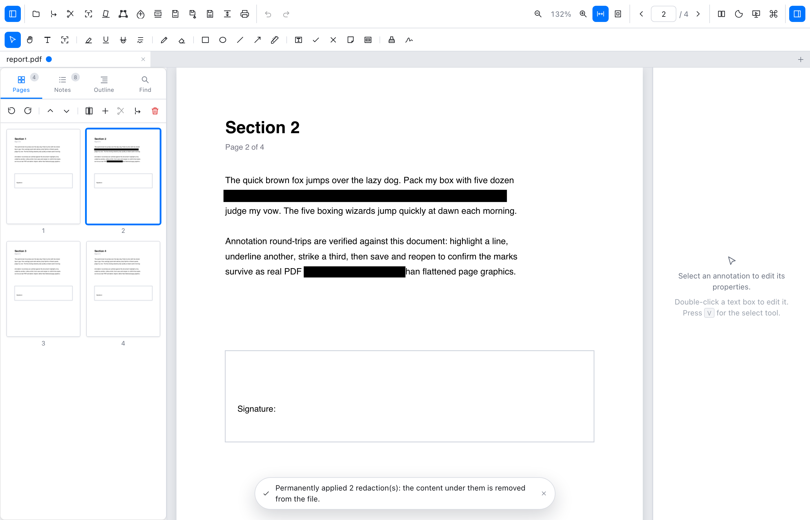
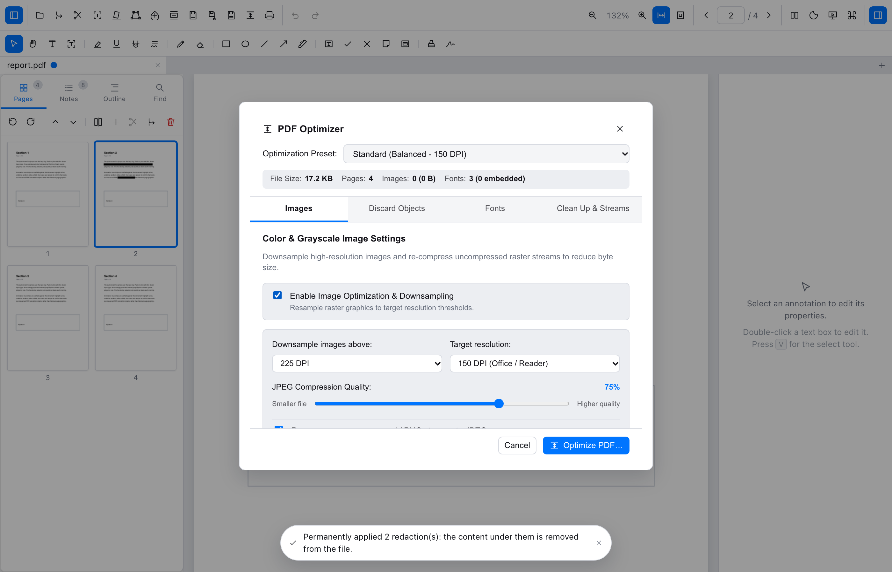
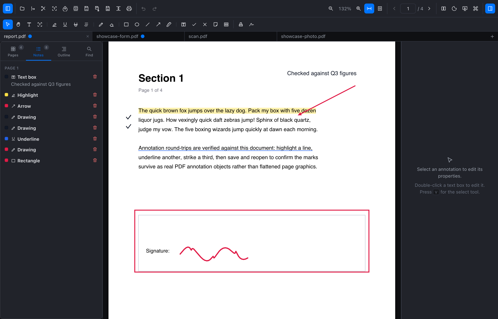

# VrushPDF

  <strong>A fast, lightweight, privacy-first desktop PDF editor for macOS, Windows and Linux.</strong>
   
  <em>Annotate, fill and sign, make scans searchable, and assemble documents, entirely offline.</em>

  
  
  
  
  

  

---

## 🆕 New in 1.0

- **🔎 OCR, built in and offline**: make scanned PDFs searchable and selectable, or drag a box over any scan to copy its text. English, German, French, Spanish, Italian and Dutch.
- **📐 Scan clean-up**: straighten crooked scans automatically, and correct the perspective of phone photos of documents, with the corners found for you.
- **☑️ Fill any form**: tick and cross marks and text boxes for printed forms that have no fillable fields.
- **✍️ Faster annotating**: resize anything with handles, copy and paste annotations, type exact sizes, and save any annotation's look as the default for its kind.
- **🔄 Automatic updates**: VrushPDF checks for new versions and installs them for you.

---

## 📸 Feature Showcase

<table>
  <tr>
    <td align="center" width="50%">
      
       
      <b>📖 Viewer & Multi-Tab Workspace</b>
      
<em>Smooth continuous scrolling, page thumbnails with drag-and-drop reordering, search and bookmarks</em>

    </td>
    <td align="center" width="50%">
      
       
      <b>✍️ Annotation & Markup Studio</b>
      
<em>Highlights, shapes, arrows, text boxes, ticks and freehand ink, with a live properties panel</em>

    </td>
  </tr>
  <tr>
    <td align="center" width="50%">
      
       
      <b>🖋️ Forms, Signatures & Stamps</b>
      
<em>Fill interactive fields, tick and cross printed boxes, sign, and stamp</em>

    </td>
    <td align="center" width="50%">
      
       
      <b>🔎 OCR: Searchable Scans</b>
      
<em>Recognise text on scanned pages, or drag a box to copy text out of any scan</em>

    </td>
  </tr>
  <tr>
    <td align="center" width="50%">
      
       
      <b>📐 Straighten & Correct Perspective</b>
      
<em>Fix tilted scans automatically; turn phone photos into flat, upright pages</em>

    </td>
    <td align="center" width="50%">
      
       
      <b>⬛ True Redaction</b>
      
<em>Removes exactly what's under each box from the file: words, image pixels and drawings</em>

    </td>
  </tr>
  <tr>
    <td align="center" width="50%">
      
       
      <b>🗜️ PDF Optimizer & Compression</b>
      
<em>Image downsampling (72–300 DPI), stream clean-up, font unembedding, one-click presets</em>

    </td>
    <td align="center" width="50%">
      
       
      <b>🌙 Dark Mode & Native Theming</b>
      
<em>Follows your system's light or dark appearance, with styling for macOS, Windows, GNOME and KDE</em>

    </td>
  </tr>
</table>

---

## 🚀 Why VrushPDF?

Most PDF editors are either slow, cloud-tethered apps that use gigabytes of memory, or expensive software with monthly subscriptions. **VrushPDF** is built to be different:

- **⚡ Native performance**: built on **Tauri 2**, **Rust** and **Svelte 5**. Starts instantly, scrolls smoothly and uses little memory.
- **🛡️ Standard, editable annotations**: annotations are saved as **real PDF annotation objects** with proper appearances. They stay editable in VrushPDF *and* in Apple Preview, Adobe Acrobat and Google Chrome; nothing is flattened into the page unless you choose to.
- **🔒 Private and fully offline**: your documents never leave your computer. No telemetry, no cloud, no account. Even OCR runs locally.
- **🎨 At home on every desktop**: styling tailored to macOS, Windows (Fluent), GNOME (Adwaita) and KDE Plasma (Breeze).
- **💰 Fair pricing**: no subscription. A 14-day fully featured trial, then a single one-time purchase.

---

## ✨ Features at a Glance

### 📖 Viewing & Navigation
- **Multi-document tabs** with their own zoom, scroll position and undo history.
- **Continuous scrolling**, fit-width and fit-page zoom, single or **two-page spreads** (with or without a cover page).
- **Reading filters** (dark, sepia, inverted) and a full-screen **presentation mode** (`F5`).
- **Whole-document search** that also finds text in rotated pages, and **bookmarks / table of contents** navigation.
- **Command palette** (`⌘K` / `Ctrl+K`): every tool and command, a few keystrokes away.
- **Password-protected PDFs**: opened seamlessly and re-encrypted with AES-128 when saved.

### ✍️ Annotation & Markup
- **Text markup**: highlight, underline, strikeout and squiggly, from a real text selection.
- **Drawing & shapes**: freehand pen, eraser, rectangle, ellipse, line, arrow, and a **measuring tool** with real-world units.
- **Text boxes**: font, size, bold and italic, alignment, padding, borders and background (or white-out).
- **Comments**: sticky notes and comments on any annotation, edited in place; a right-click menu on every page.
- **Edit with ease**: resize any annotation with handles, **copy and paste** annotations (`⌘C` / `⌘V`), align them on the page, and type exact sizes or use a slider.
- **Your defaults**: "Use as default" saves an annotation's look for its kind; Settings lists every kind's default style, with reset.
- **Built for flow**: new annotations stay unselected, so you can add one after another.
- **Deep undo and redo** across annotations and page changes.

### 🔎 OCR & Scan Clean-Up
- **Make scans searchable**: recognised text is added as an invisible text layer, so search, selection and copy work in VrushPDF and every other viewer. Pages that already have text are skipped.
- **Copy text from a scan**: drag a box over any part of a page to copy the text in it.
- **Six languages built in**: English, German, French, Spanish, Italian and Dutch. Sideways and upside-down pages are recognised too.
- **Straighten crooked scans**: the tilt of each page is measured and corrected automatically.
- **Correct perspective**: turn a phone photo of a document into a flat, upright page. The document's corners are found for you and can be adjusted by hand.

### 🖋️ Forms, Signatures & Stamps
- **Interactive forms**: text fields, checkboxes, radio buttons, dropdowns and list boxes, saved as standard PDF form data.
- **Printed forms**: tick (`C`) and cross (`⇧C`) marks and text boxes fill in forms that have no fillable fields.
- **Reusable signatures**: draw once, place anywhere.
- **Stamps**: *APPROVED*, *REVIEWED*, *DRAFT*, *CONFIDENTIAL* and *FINAL*, or your own images.

### 📄 Pages & Document Assembly
- **Reorder, insert, rotate and delete** pages from the thumbnail sidebar.
- **Merge** other PDFs into the current one, keeping their bookmarks.
- **Split & extract**: pull out page ranges, or split a document every *n* pages.
- **Watermarks**, and **headers, footers & Bates numbering**.

### ⬛ True Redaction
- **Removes, not just covers**: applying a redaction deletes what lies under each box from the file itself, then draws an opaque box (with an optional label) in its place.
- **Precise to the character**: only the words under a box go; the rest of the line, and the lines around it, stay exactly where they were.
- **Scans too**: the covered pixels of a scanned page are blanked; the rest of the image is kept.
- **Thorough**: text and images inside embedded graphics, drawings under a box, annotations, and form field values are all removed.
- **Redact text or areas**: mark a selection of text (one box per line) or drag a box over any area with the Redact tool (`D`).

### 🗜️ Optimize, Secure & Print
- **PDF optimizer**: image downsampling (72–300 DPI) with JPEG quality control, removal of unused objects and metadata, font unembedding, object-stream compression, and one-click presets.
- **Flattened saving** (`⌥⌘S` / `Alt+Shift+S`): burn annotations, signatures and form fields into the page, with a reminder when saving signed documents unflattened.
- **Native printing** (`⌘P` / `Ctrl+P`) with annotations, form values and rotations.

### 🔄 Always Up to Date
- **Automatic updates**: VrushPDF checks for new releases and installs them for you, or check any time from the menu.

---

## 💎 Pricing & Licensing

VrushPDF believes in software ownership, not perpetual rental.

| Plan | Price | Details |
| :--- | :--- | :--- |
| **14-Day Free Trial** | **Free** | Every feature unlocked from day one. No credit card, no account. |
| **Personal Lifetime License** | **One-Time Purchase** | Lifetime access and all future updates. Use it on all your personal computers. |

- **No subscription**: pay once, keep it forever.
- **Offline activation**: license keys (`VRSH.…`) are verified on your computer. The app never contacts a license server.
- **Get a license**: buy through [Paddle Checkout](https://vrushpdf.app/buy), then activate in the app via **VrushPDF ▸ Enter License…** (macOS) or **Help ▸ Enter License…** (Windows and Linux).

---

## ⌨️ Essential Keyboard Shortcuts

| macOS | Windows / Linux | Action |
| :--- | :--- | :--- |
| `⌘O` | `Ctrl+O` | Open PDF |
| `⌘W` | `Ctrl+W` | Close tab |
| `⌘S` | `Ctrl+S` | Save |
| `⌥⌘S` | `Alt+Shift+S` | Save flattened PDF |
| `⌥⌘O` | `Alt+Ctrl+O` | PDF optimizer |
| `⌘P` | `Ctrl+P` | Print |
| `⌘F` / `⌘G` | `Ctrl+F` / `Ctrl+G` | Find / find next |
| `⌘K` | `Ctrl+K` | Command palette |
| `⌘Z` / `⇧⌘Z` | `Ctrl+Z` / `Ctrl+Shift+Z` | Undo / redo |
| `⌘C` / `⌘X` / `⌘V` | `Ctrl+C` / `Ctrl+X` / `Ctrl+V` | Copy / cut / paste annotations |
| `⌘\` | `Ctrl+\` | Toggle sidebar |
| `⌘0` / `⌥⌘0` | `Ctrl+0` / `Ctrl+Alt+0` | Fit page / actual size |
| `F5` | `F5` | Presentation mode |
| `V` / `H` / `T` | `V` / `H` / `T` | Select / pan / select text |
| `1` / `2` / `3` / `4` | `1` / `2` / `3` / `4` | Highlight / underline / strikeout / squiggly |
| `P` / `E` | `P` / `E` | Pen / eraser |
| `R` / `O` / `L` / `A` / `M` | `R` / `O` / `L` / `A` / `M` | Rectangle / ellipse / line / arrow / measure |
| `X` / `N` / `S` | `X` / `N` / `S` | Text box / comment / signature |
| `D` | `D` | Redact |
| `C` / `⇧C` | `C` / `Shift+C` | Tick / cross mark |

---

## 📦 Downloads & Installation

Installers for every platform are on the [**Releases**](https://github.com/nashv/VrushPDF/releases/latest) page:

| Operating System | Packages | Notes |
| :--- | :--- | :--- |
| **macOS** | `.dmg` | Separate downloads for Apple Silicon (`aarch64`) and Intel (`x64`). |
| **Windows** | `-setup.exe` (NSIS), `.msi` | Windows 10 and 11, 64-bit. |
| **Linux** | `.AppImage`, `.deb`, `.rpm` | Universal AppImage, Debian/Ubuntu and Fedora/RHEL (`x86_64`). |

Each release includes `SHA256SUMS.txt` to verify your download.

### Installation notes (unsigned builds)
VrushPDF is not yet signed with commercial developer certificates:
- **macOS**: if Gatekeeper says the app *"cannot be opened because the developer cannot be verified"*, **right-click ▸ Open** it once, or run `xattr -cr /Applications/VrushPDF.app`.
- **Windows**: if Microsoft Defender SmartScreen appears, click **More info ▸ Run anyway**.
- **Linux**: make the AppImage executable with `chmod +x VrushPDF*.AppImage`, then run it.

---

  <strong>VrushPDF</strong>: a faster, truly private PDF editor.

